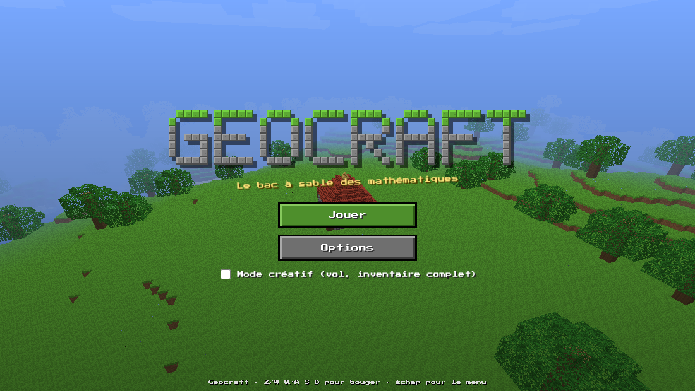
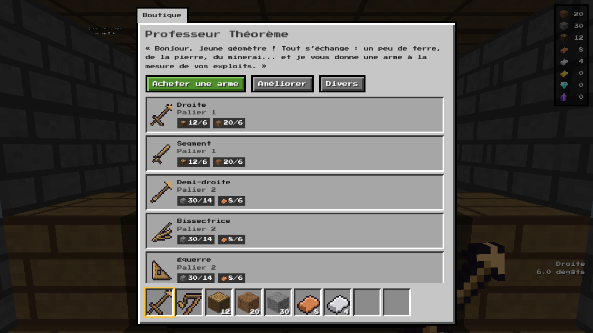
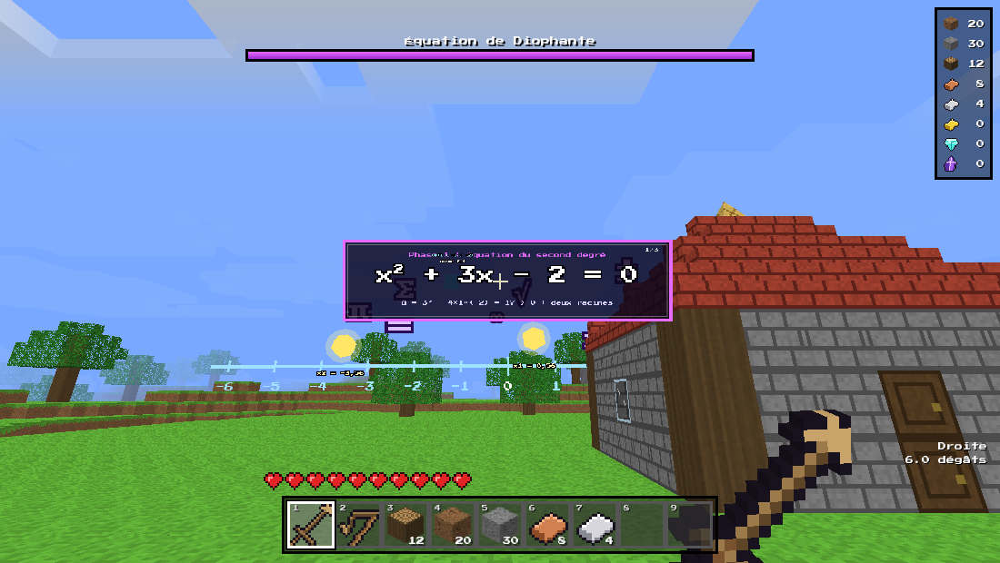

# Geocraft

Geocraft est un jeu de voxels jouable dans un navigateur, construit autour des mathématiques et de la géométrie. Le monde est généré de façon procédurale, les armes sont des objets géométriques (droite, médiatrice, équerre, compas, rapporteur, signes opératoires...), les monstres sont des fractions, les ennemis volants sont des vecteurs et les boss sont des équations dont il faut frapper les racines.

Le jeu est écrit en TypeScript avec Vite et Three.js. Il n'utilise aucun fichier externe : les textures sont dessinées par code sur un canvas, les sons sont synthétisés avec la Web Audio API, et la police pixel est embarquée dans le build.



## Sommaire

- [Jouer](#jouer)
- [Contenu du jeu](#contenu-du-jeu)
- [Développement local](#développement-local)
- [Déploiement sur le serveur](#déploiement-sur-le-serveur)
  - [1. Enregistrements DNS](#1-enregistrements-dns)
  - [2. Cloner le dépôt](#2-cloner-le-dépôt)
  - [3. Configurer le fichier .env](#3-configurer-le-fichier-env)
  - [4. Construire et lancer le conteneur](#4-construire-et-lancer-le-conteneur)
  - [5. Brancher le reverse proxy](#5-brancher-le-reverse-proxy)
  - [6. Vérifier le certificat et le site](#6-vérifier-le-certificat-et-le-site)
  - [7. Mettre le jeu à jour](#7-mettre-le-jeu-à-jour)
  - [Dépannage](#dépannage)
- [Structure du dépôt](#structure-du-dépôt)
- [Tests](#tests)

## Jouer

| Action | Touche |
| --- | --- |
| Se déplacer | Z Q S D ou W A S D (les deux fonctionnent) |
| Sauter, courir, s'accroupir | Espace, Maj, Ctrl |
| Frapper ou miner (maintenu pour miner en continu) | Clic gauche |
| Poser un bloc, ouvrir une porte, utiliser l'objet, lever un bouclier | Clic droit |
| Choisir un objet de la barre rapide | Molette ou touches 1 à 9 |
| Inventaire | E |
| Fabrication | C |
| Parler au Professeur Théorème | F |
| Régler l'arme (rayon du compas, angle du rapporteur) | R |
| Menu pause | Échap |
| Plein écran | F11 |

Toutes les touches se reprogramment dans Options. Le jeu se joue entièrement au clavier et à la souris.

Le jeu se sauvegarde automatiquement dans le navigateur (IndexedDB) : modifications du monde, inventaire, position, vie et heure. Le bouton « Repartir d'un monde neuf » (écran titre et menu pause) efface la sauvegarde. La sauvegarde est liée au nom de domaine du site : elle reste dans le navigateur du joueur et ne passe jamais par le serveur.

## Contenu du jeu

**Monde.** Plaines, forêts, déserts, montagnes enneigées, lacs, grottes et cavernes. Minerais enterrés par profondeur : cuivre, fer, or, diamant, et le cristal d'Euclide, rare et profond. Les ruines de Pythagore (triangle rectangle 9-12-15 en pierre taillée) abritent un autel et un cristal enfoui. La cabane du Professeur Théorème se trouve près du point de départ.

**Armes.** 27 familles d'armes, chacune en 7 matériaux (bois, pierre, cuivre, fer, or, diamant, cristal d'Euclide) : droite, segment, demi-droite, médiatrice, médiane, bissectrice, équerre, compas, rapporteur, signes plus, moins, multiplication, division et égal, racine carrée, pi, parallèles, perpendiculaire, triangle, carré, rectangle, ovale, losange, trapèze, hexagone, sinus et intégrale. Chaque arme sert aussi d'outil (pioche, hache ou pelle selon sa nature) et le matériau change dégâts et vitesse de minage.

**Ennemis.** Les fractions (propres, impropres, décimales, irréductibles blindées, négatives) portent leur fraction sur le corps ; numérateur et dénominateur fixent vie et dégâts. Diviser fragmente, multiplier renforce, additionner fusionne deux fractions proches, soustraire ralentit. Les vecteurs sont des flèches volantes qui affichent leur direction et leur norme, chargent en ligne droite et se dévient par somme de vecteurs (équerre, signe plus). Ils apparaissent surtout de nuit et dans les cavernes, avec une difficulté qui monte avec la profondeur et le temps de jeu.

**Boss.** Une équation à trois phases (degré 2, degré 3, bicarrée) flotte devant le joueur. Ses racines sont des points lumineux posés sur une droite graduée : les frapper fait avancer la phase. L'autel des ruines de Pythagore (clic droit) l'invoque. L'autel se fabrique aussi : 4 pierres taillées et 1 diamant.

**Boutique et fabrication.** Le Professeur Théorème échange terre, pierre, bois, cuivre, fer, or, diamant et cristal d'Euclide contre des armes, puis les améliore vers un matériau supérieur. La fabrication transforme le bois en planches, portes, échelles, escaliers et toits, cuit le verre, taille la pierre en briques, créneaux, escaliers, et produit des prismes, pyramides et demi-sphères pour bâtir maisons, châteaux, tours et ponts.

**Mode créatif.** Case à cocher sur l'écran titre : inventaire complet, vol (double appui sur Espace) et aucun dégât.





## Développement local

Prérequis : Node.js 20 ou plus récent.

```bash
npm ci
npm run dev        # http://localhost:5173
npm run build      # vérification TypeScript puis build dans dist/
npm run preview    # sert dist/ sur http://localhost:4173
```

## Déploiement sur le serveur

La procédure suppose un serveur OVH sous Linux avec Docker Engine et Docker Compose v2, `git`, et un reverse proxy déjà installé dans la stack Docker (Traefik, Nginx Proxy Manager ou Caddy). Dans les exemples, le domaine est `exemple.fr` : remplacez-le par le vôtre. Le jeu sera servi sur `https://geocraft.exemple.fr`.

Le conteneur contient nginx et les fichiers statiques du jeu. nginx écoute sur un port interne (8080 par défaut, réglable avec `PORT` dans `.env`), compresse les réponses en gzip et applique un cache d'un an aux fichiers hachés de `/assets/`. La page d'entrée `index.html` est toujours revalidée, ce qui rend les mises à jour visibles dès le rechargement.

### 1. Enregistrements DNS

Dans la zone DNS du domaine (espace client OVH : Noms de domaine, puis Zone DNS, puis Ajouter une entrée) :

| Type | Sous-domaine | Cible |
| --- | --- | --- |
| A | `geocraft` | adresse IPv4 du serveur |
| AAAA | `geocraft` | adresse IPv6 du serveur (seulement si le serveur et le reverse proxy répondent en IPv6) |

L'enregistrement AAAA est facultatif. Un AAAA qui pointe vers une adresse IPv6 injoignable provoque des échecs de connexion et de certificat, donc il ne se crée que si l'IPv6 fonctionne vraiment (`curl -6 https://ifconfig.co` depuis le serveur).

Vérifier la propagation depuis le serveur ou un poste quelconque :

```bash
dig +short A geocraft.exemple.fr
dig +short AAAA geocraft.exemple.fr
```

La réponse doit contenir l'adresse du serveur avant de demander un certificat. Les ports 80 et 443 doivent être ouverts vers le reverse proxy (pare-feu OVH et pare-feu du serveur) : Let's Encrypt valide le domaine par le port 80 ou 443.

### 2. Cloner le dépôt

```bash
cd /opt          # ou le dossier qui regroupe vos stacks
git clone https://github.com/tuxrom/Geocraft.git
cd Geocraft
```

### 3. Configurer le fichier .env

```bash
cp .env.example .env
nano .env
```

| Variable | Rôle | Valeur par défaut |
| --- | --- | --- |
| `DOMAIN` | domaine de base : le jeu est servi sur `geocraft.<DOMAIN>` | `exemple.fr` |
| `PORT` | port d'écoute interne du conteneur (nginx) ; le reverse proxy doit viser ce port | `8080` |
| `HOST_PORT` | port publié sur l'hôte | `8080` |
| `BIND_ADDRESS` | adresse d'écoute de l'hôte : `127.0.0.1` (local seulement) ou `0.0.0.0` | `127.0.0.1` |
| `TZ` | fuseau horaire des journaux | `Europe/Paris` |
| `PROXY_NETWORK` | nom du réseau Docker du reverse proxy (voir `docker network ls`) | `proxy` ou `traefik` |
| `COMPOSE_FILE` | fichiers Compose actifs, pour activer une surcharge de reverse proxy | non défini |

Sans reverse proxy dans Docker, la configuration par défaut suffit : le jeu répond sur `http://127.0.0.1:8080` depuis le serveur.

### 4. Construire et lancer le conteneur

```bash
docker compose up -d --build
docker compose ps          # l'état doit passer à « healthy » en quelques secondes
docker compose logs -f     # Ctrl+C pour quitter les journaux
curl -I http://127.0.0.1:8080    # doit répondre 200 OK
```

Le build se fait en deux étapes : Node construit le jeu avec Vite, puis nginx ne conserve que les fichiers statiques. Le premier build télécharge les dépendances npm et demande une à deux minutes. Les suivants réutilisent le cache.

### 5. Brancher le reverse proxy

Choisir le cas qui correspond à la stack existante.

#### Traefik (v2 ou v3)

Prérequis : Traefik a un point d'entrée HTTPS (`websecure`) et un résolveur de certificats (`letsencrypt`) ; il lit les conteneurs via le socket Docker et partage un réseau avec les services (`traefik` dans l'exemple).

Dans `.env` :

```env
DOMAIN=exemple.fr
PROXY_NETWORK=traefik
COMPOSE_FILE=docker-compose.yml:docker-compose.traefik.yml
# si les noms diffèrent dans votre configuration Traefik :
# TRAEFIK_ENTRYPOINT=websecure
# TRAEFIK_CERTRESOLVER=letsencrypt
```

Puis `docker compose up -d --build`. Le fichier `docker-compose.traefik.yml` rattache le conteneur au réseau de Traefik et ajoute ces étiquettes (équivalent explicite) :

```yaml
labels:
  - "traefik.enable=true"
  - "traefik.docker.network=traefik"
  - "traefik.http.routers.geocraft.rule=Host(`geocraft.exemple.fr`)"
  - "traefik.http.routers.geocraft.entrypoints=websecure"
  - "traefik.http.routers.geocraft.tls=true"
  - "traefik.http.routers.geocraft.tls.certresolver=letsencrypt"
  - "traefik.http.services.geocraft.loadbalancer.server.port=8080"
```

Traefik demande le certificat dès que le routeur apparaît, à condition que le DNS soit en place. La redirection HTTP vers HTTPS reste celle déjà configurée dans Traefik (redirection globale du point d'entrée `web`).

#### Nginx Proxy Manager

Deux variantes selon la manière de joindre le conteneur.

*Variante A, réseau Docker partagé (recommandée).* Dans `.env` :

```env
PROXY_NETWORK=nom_du_reseau_de_npm      # visible avec: docker network ls
COMPOSE_FILE=docker-compose.yml:docker-compose.proxy.yml
```

Relancer `docker compose up -d --build`, puis dans l'interface de Nginx Proxy Manager, Hosts, Proxy Hosts, Add Proxy Host :

| Champ | Valeur |
| --- | --- |
| Domain Names | `geocraft.exemple.fr` |
| Scheme | `http` |
| Forward Hostname / IP | `geocraft` |
| Forward Port | `8080` (la valeur de `PORT`) |
| Block Common Exploits | activé |

Onglet SSL : choisir « Request a new SSL Certificate », activer Force SSL, HTTP/2 Support et HSTS, accepter les conditions de Let's Encrypt, puis enregistrer.

*Variante B, adresse de l'hôte.* Dans `.env`, mettre `BIND_ADDRESS=0.0.0.0` et laisser `HOST_PORT=8080`. Dans Nginx Proxy Manager, Forward Hostname / IP reçoit l'adresse IP du serveur (ou de la passerelle Docker, souvent `172.17.0.1`) et Forward Port reçoit `8080`. Le port 8080 devient alors joignable depuis Internet s'il n'est pas filtré : ouvrir seulement 80 et 443 dans le pare-feu.

#### Caddy

*Caddy dans Docker.* Rattacher le conteneur au réseau de Caddy, dans `.env` :

```env
PROXY_NETWORK=nom_du_reseau_de_caddy
COMPOSE_FILE=docker-compose.yml:docker-compose.proxy.yml
```

Ajouter ce bloc au `Caddyfile` :

```caddyfile
geocraft.exemple.fr {
    encode zstd gzip
    reverse_proxy geocraft:8080
}
```

Recharger la configuration : `docker exec -w /etc/caddy <nom_du_conteneur_caddy> caddy reload`.

*Caddy installé sur l'hôte.* Le même bloc, avec la cible locale :

```caddyfile
geocraft.exemple.fr {
    encode zstd gzip
    reverse_proxy 127.0.0.1:8080
}
```

Puis `sudo systemctl reload caddy`.

Dans les deux cas, Caddy obtient et renouvelle le certificat tout seul dès la première requête vers le domaine, et redirige HTTP vers HTTPS. Avec le plugin `caddy-docker-proxy`, les étiquettes `caddy=geocraft.exemple.fr` et `caddy.reverse_proxy={{upstreams 8080}}` sur le service remplacent le bloc de Caddyfile.

### 6. Vérifier le certificat et le site

```bash
# réponse HTTPS et en-têtes
curl -I https://geocraft.exemple.fr

# émetteur et dates du certificat
echo | openssl s_client -connect geocraft.exemple.fr:443 -servername geocraft.exemple.fr 2>/dev/null \
  | openssl x509 -noout -issuer -subject -dates

# compression et cache des fichiers du jeu
curl -sI -H 'Accept-Encoding: gzip' https://geocraft.exemple.fr/ | grep -i -E 'HTTP|encoding'
```

L'émetteur doit être Let's Encrypt (ou celui du résolveur configuré) et la date de fin postérieure à aujourd'hui. Dans un navigateur, le cadenas doit être fermé, l'écran titre Geocraft apparaît et le bouton Jouer lance la génération du monde.

### 7. Mettre le jeu à jour

```bash
cd /opt/Geocraft
git pull
docker compose up -d --build
docker image prune -f        # facultatif : supprime les anciennes images
```

La reconstruction ne touche que ce qui a changé. Les parties des joueurs restent dans leur navigateur, elles survivent donc aux mises à jour.

### Dépannage

| Symptôme | Piste |
| --- | --- |
| `docker compose ps` indique « unhealthy » | `docker compose logs geocraft`. Une valeur de `PORT` incohérente entre `.env` et le reverse proxy en est la cause la plus fréquente. |
| 502 Bad Gateway | Le proxy vise un mauvais nom ou un mauvais port : le nom est `geocraft`, le port est la valeur de `PORT`. Vérifier aussi que les deux conteneurs partagent un réseau (`docker network inspect <reseau>`). |
| Le certificat n'est pas émis | Le DNS ne pointe pas encore vers le serveur, ou les ports 80 et 443 sont filtrés. Consulter les journaux du proxy. |
| `network proxy declared as external, but could not be found` | `PROXY_NETWORK` ne correspond à aucun réseau : relever le nom exact avec `docker network ls`. |
| Écran noir ou jeu qui ne démarre pas | Le navigateur doit prendre en charge WebGL 2 et les Web Workers. Ouvrir la console du navigateur (F12) pour lire l'erreur. |
| Anciennes versions affichées après mise à jour | Rechargement forcé (Ctrl+F5). `index.html` n'est jamais mis en cache, mais un proxy intermédiaire peut en garder une copie. |

## Structure du dépôt

```
index.html            page d'entrée
src/
  core/               bruit simplex, générateur aléatoire, constantes
  data/               blocs, objets, armes, recettes, boutique
  world/              génération du terrain, maillage (greedy), worker, chunks
  gfx/                textures, icônes, ciel, matériaux, modèles d'objets
  game/               joueur, physique, interaction, combat, ennemis, boss, sauvegarde, audio
  ui/                 écran titre, options, HUD, inventaire, boutique, fabrication
Dockerfile            build Vite puis nginx
nginx.conf.template   nginx : compression, cache, port configurable
docker-compose*.yml   lancement et surcharges de reverse proxy
.env.example          réglages du déploiement
tests/                scripts Playwright (voir ci-dessous)
```

## Tests

Les scripts de `tests/` pilotent un vrai Chromium avec Playwright. Ils attendent un serveur de développement sur `http://127.0.0.1:5173` (`npm run dev`) ; `tests/prod.cjs` accepte l'adresse d'un build servi par nginx.

```bash
npm run dev &
node tests/m1.cjs      # lancement du jeu et déplacement
node tests/m3.cjs      # les 27 armes, une par une
node tests/m4.cjs      # boutique, amélioration, fabrication
node tests/m5.cjs      # boss, phases, butin
node tests/m6.cjs      # sauvegarde, rechargement, monde neuf
node tests/prod.cjs http://127.0.0.1:8080/
```

Les captures sont écrites dans `tests/out/` (ignoré par git).
